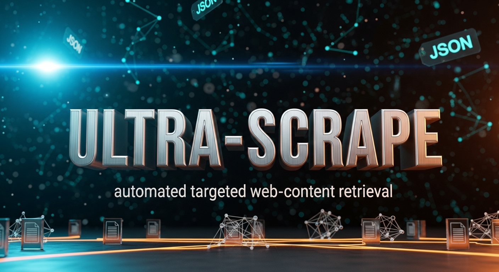
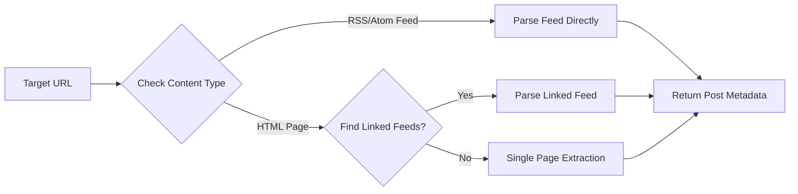
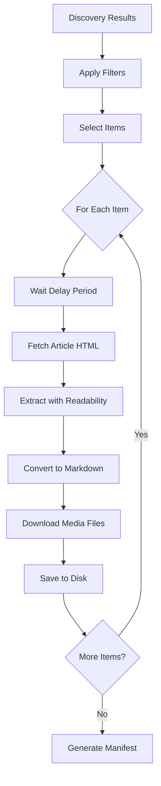

# UltraScrape: Targeted Web Article Archiver for Claude Code

<div align="center">
  
</div>


Discover articles via RSS, Atom, or static HTML, then save selected articles as Markdown with metadata and optional local images.

---

## 📦 Installation

### Set up a local checkout

Install Git, Node.js 20.18.1 or later, and npm 9 or later. Claude Code is
required only for the slash command; the Node.js engines run independently.
Dependency installation and offline checks were exercised on Linux with
Node.js 22.22.2 and npm 10.9.7. Claude Code 2.1.318 recognizes the loading
option below and validates the plugin manifest.

1. Clone into a directory you own and install the locked dependencies:

   ```bash
   git clone https://github.com/justfinethanku/Ultra-Scrape.git
   cd Ultra-Scrape
   npm ci
   ```

2. Verify both engines without contacting a live website:

   ```bash
   node test/offline-smoke.mjs
   ```

   Expect six `PASS` lines covering discovery and downloads with and without
   media. The check starts a temporary loopback server and removes its output.

3. Start Claude Code with this checkout loaded:

   ```bash
   claude --plugin-dir "$(pwd)"
   ```

   This loads the plugin for that session. Open `/help` and check for
   `/ultrascrape:ultrascrape`. Repeat `--plugin-dir` for later sessions.
   Merely cloning into `~/.claude/plugins/marketplaces/` does not install or
   enable a plugin. See [Claude Code's plugin loading guide](https://code.claude.com/docs/en/plugins#make-an-installed-plugin-available-in-your-session).

`node_modules/` is generated locally and is not included in Git. After updating
your checkout with `git pull --ff-only`, run `npm ci` again and start a new
Claude Code session with `--plugin-dir`. This checkout-based path keeps the
installed dependencies beside the scripts; a marketplace's cached copy is a
separate installation and needs its own dependencies.

---

## ⚡ Quick Start

**Just installed? Run the slash command:**

> `/ultrascrape:ultrascrape Discover articles at YOUR_FEED_URL, then download at most 5 to an absolute output directory I provide.`

Replace `YOUR_FEED_URL` with a real RSS/Atom feed or static article URL. The
example domains throughout this README are placeholders. The slash command
collects inputs conversationally; the engine flags below are for direct Node.js use.

**Common patterns:**

| What you want | Say this to Claude |
|---------------|-------------------|
| Discover available articles | "Run `/ultrascrape:ultrascrape [URL] --limit 50` and show me what you found before downloading" |
| Download the first articles in feed order | "`/ultrascrape:ultrascrape [URL] --limit 10 --output [folder]`" |
| Filter by topic | "`/ultrascrape:ultrascrape [URL] --filters '{\"tags\":[\"[topic]\"]}'`" |
| Archive a blog | "`/ultrascrape:ultrascrape [URL] --delay 2000 --output ./archive`" |
| Build a dataset | "Download up to 20 articles from [URL], without media, to [absolute folder]." |

---

## 🚀 What is UltraScrape?

UltraScrape is a Claude Code plugin that solves the "Bulk Scraping vs Targeted Retrieval" problem. Most web scrapers crawl everything indiscriminately, hammering servers and downloading content you don't need. UltraScrape takes a different approach.

It maintains a two-phase workflow:
1. **Discovery Engine**: Reads RSS/Atom feeds, follows an HTML page's first linked feed, or treats the target as one article
2. **Download Engine**: Fetches selected articles with a configurable delay before each article

(Think of it as "window shopping before buying" - you browse the catalog first, then only download what matters. Your bandwidth and their servers both thank you.)

When you run discovery, UltraScrape reads feeds or page metadata, then lets you filter by date, tags, or explicit URLs before downloading. Each downloaded article becomes Markdown with extracted metadata, extracted HTML, and optional local images.

### Why Natural Language?

Traditional CLI tools make you memorize flags like `--filters '{"dateRange":{"start":"2024-01-01"}}'`. With UltraScrape and Claude Code, you just say "articles from 2024" and Claude translates that into the right commands.

| Old Way | New Way |
|---------|---------|
| `node scripts/download-engine.js https://blog.com/feed --filters '{"limit":10,"tags":["ai"]}'` | "Download 10 AI articles from https://blog.com/feed" |
| Look up documentation | "Claude, what can UltraScrape do?" |
| Debug command syntax | "That didn't work, can you fix it?" |

(No more Stack Overflow at 2 AM. You're welcome.)

### Key Features

- 🔍 **Smart Discovery**: Automatically detects RSS/Atom feeds, linked feeds, or falls back to single-page extraction
- 🎯 **Targeted Downloads**: Filter by date range, exact tags, or explicit URLs before fetching
- ⏱️ **Article Delays**: Wait 1000 ms before each article fetch by default; discovery and image requests do not use this delay
- 📝 **Clean Mike Dion Files**: Uses Mozilla Readability for article extraction, Turndown for Markdown conversion
- 📦 **Article Archives**: Saves Markdown, metadata JSON, extracted HTML, and optional images per article
- 🛡️ **Built-in Safeguards**: User agent identification, configurable limits, delay mechanisms
- 🔄 **Structured Output**: Domain-organized directories with manifest files for easy navigation
- 📊 **Progress Tracking**: Real-time console feedback during discovery and download phases

---

## 🚦 How It Works

UltraScrape uses a two-phase approach to ensure targeted, respectful web archiving:

### Phase 1: Discovery



The discovery engine:
1. Fetches the target URL
2. Detects if it's a feed, has linked feeds, or is a single page
3. Extracts article metadata (title, URL, date, description, tags)
4. Returns structured discovery data with up to 50 items (configurable)

### Phase 2: Download



The download engine:
1. Takes discovery results and applies your filters (date range, tags, limit)
2. Fetches each article HTML with a configurable delay before each article
3. Uses Mozilla Readability to extract clean article content
4. Converts to Markdown via Turndown
5. Downloads images and media to local `media/` directory
6. Saves `index.md`, `metadata.json`, and extracted article HTML in `original.html`
7. Updates domain manifest (`index.json`) for tracking

---

## 🛠️ Usage

Use the namespaced slash command inside Claude Code: `/ultrascrape:ultrascrape`. Claude will ask you for the URL, output folder, limits, delay, and media preference—no flags to remember. The prompts below are phrased conversationally; just ask Claude to run the command and answer its questions.

### Basic Discovery

**Copy-paste these prompts:**

> "Claude, use UltraScrape to discover what articles are available at https://blog.example.com/feed.xml"

> "Find all articles from https://techblog.com/rss and show me what's available"

> "Discover articles from https://news.site/feed but limit it to 100 items"

### Basic Download

> "Claude, download articles from https://blog.example.com/feed.xml to ./my-archive"

> "Use UltraScrape to fetch articles from https://myblog.com/rss and save them as Markdown"

### Advanced Filtering

> "Download the first 5 articles in feed order from https://blog.example.com/feed.xml"

> "Fetch articles from https://blog.site/rss from 2024 only and save to ./2024-articles"

> "Download articles tagged with 'ai' or 'machine-learning' from https://techblog.com/feed"

> "Get the first 10 articles tagged JavaScript in feed order from https://devblog.com/rss published after June 2024"

### Rate Limiting & Politeness

> "Download articles from https://blog.example.com/feed.xml but use a 2 second delay between requests to be extra polite"

> "Fetch articles from https://news.site/rss without downloading media files - text only"

> "Very politely download 5 articles from https://blog.com/feed with 3 second delays and no media"

### Combining Options

> "Claude, discover articles from https://devblog.com/feed, filter for articles about TypeScript from 2024, download only 10 of them with images to ./ts-articles, and use 2 second delays"

---

## 📊 Output Structure

Each downloaded article creates this structure:

```
output/
└── blog.example.com/
    ├── index.json                    # Appended entries for successful downloads
    ├── 2024-01-15-article-title-slug/
    │   ├── index.md                  # Clean Markdown version
    │   ├── metadata.json             # Structured metadata (title, date, author, etc.)
    │   ├── original.html             # Extracted article HTML with rewritten image paths
    │   └── media/
    │       ├── image-001.jpg         # Downloaded images
    │       ├── image-002.png
    │       └── diagram.svg
    └── undated-another-article/
        ├── index.md
        ├── metadata.json
        ├── original.html
        └── media/
```

### Markdown Output Format

Paths use the article URL's hostname and the feed date (UTC `YYYY-MM-DD`),
or `undated` for a missing/invalid date. Titles become lowercase ASCII slugs.
Running again writes into the same date/title directory and appends another
manifest entry; this is not an incremental backup or deduplication system.

Each `index.md` (Mike Dion file) includes frontmatter:

```markdown
---
title: "Article Title"
source_url: "https://blog.example.com/article"
published: "2024-01-15"
author: "Author Name"
tags:
  - "ai"
  - "programming"
---

# Article Title

Clean article content in Markdown...


```

---

The richer `metadata.json` also contains `url`, `date`, `excerpt`,
`contentLength`, `saved_at`, and the absolute `output_dir`. Optional frontmatter
fields are omitted when missing. `original.html`
contains extracted HTML, not the original HTTP response body. With
`--no-media`, the `media/` directory is empty and image URLs remain remote.

## ⚙️ What Claude Code Will Do

When you give Claude a UltraScrape prompt, here's what happens behind the scenes:

1. **Claude translates your request** into the appropriate command-line flags
2. **Runs discovery** to find available articles
3. **Shows you what was found** (count, date range, topics)
4. **Applies your filters** (date, tags, limit)
5. **Downloads the articles** with a delay before each article fetch
6. **Converts to clean Markdown** with local media
7. **Reports the results** and where files were saved

### Available Options Claude Can Use

| What you ask for | Claude will use |
|------------------|-----------------|
| "Limit to 10 articles" | `--filters '{"limit":10}'` |
| "From 2024 only" | `--filters '{"dateRange":{"start":"2024-01-01T00:00:00Z","end":"2024-12-31T23:59:59.999Z"}}'` |
| "Articles about AI" | `--filters '{"tags":["ai"]}'` |
| "2 second delays" | `--delay 2000` |
| "No images" or "text only" | `--no-media` |
| "Save to ./my-folder" | `--output ./my-folder` |

### Private network sources

Outbound requests allow public HTTP(S) destinations by default. UltraScrape
blocks loopback, private, CGNAT, link-local, unspecified, multicast, broadcast,
and reserved addresses, including IPv6 and alternate IPv4 spellings. Every DNS
answer is checked, the connection uses a checked address, and each redirect is
checked again (up to five hops). Proxy environment variables are ignored so
requests use the checked destination directly.

To archive a private source you trust, pass `--allow-private-network` after its
URL. Both CLI engines support this per-run flag:

```bash
node scripts/discovery-engine.js http://127.0.0.1:8080/article --allow-private-network
node scripts/download-engine.js http://127.0.0.1:8080/article --allow-private-network --output ./archive
```

The flag allows only the exact source request you named, including fetching
that same single page for its archive. It does not authorize linked feeds,
feed entries, images, or redirects, even on the source's own host. To archive a
private article listed by a feed, run the command with that article's URL as
the source. Embedded private media is skipped. In the JavaScript API, use
`discover(url, { allowPrivateNetwork: true })` or
`download(url, { allowPrivateNetwork: true })` for the same behavior.

### Filter Options Reference

The downloader accepts these `--filters` JSON fields:

| Field | Behavior |
|-------|----------|
| `dateRange.start`, `dateRange.end` | Inclusive date/time bounds; posts without a date remain eligible. Use explicit UTC timestamps for whole-day ranges. |
| `tags` | Any exact, case-insensitive tag match; this does not search titles or article text. |
| `urls` | Exact URL allowlist, useful after inspecting discovery results. |
| `limit` | First N matching entries, also capped by the top-level `--limit`. |

Entries stay in feed order; they are not sorted by publication date. The
downloader rediscovers at most 50 feed entries before filtering, even if you
set a higher download limit. A separate discovery command can inspect more,
but its JSON is not an input file for the download CLI. There is no built-in
keyword, title, author, or full-text filter; select URLs yourself when needed.

### Run the engines directly

Run these commands from the checkout root in a POSIX shell. Replace the URL
and output path with your own values; the output path must be a writable directory.
No Claude Code session is required.

```bash
URL='https://YOUR-SITE.example/feed.xml'
OUTPUT="$PWD/my-articles"
WORK_DIR=$(mktemp -d)
node scripts/discovery-engine.js "$URL" --limit 50 > "$WORK_DIR/discovery.json"
```

Inspect `discovery.json` before downloading. To download at most five articles
tagged `ai` from 2024 without images, run:

```bash
FILTERS_JSON='{"tags":["ai"],"dateRange":{"start":"2024-01-01T00:00:00Z","end":"2024-12-31T23:59:59.999Z"},"limit":5}'
node scripts/download-engine.js "$URL" --filters "$FILTERS_JSON" --limit 5 --delay 1000 --no-media --output "$OUTPUT" > "$WORK_DIR/download.json"
```

Discovery accepts `--limit` (default 50). Download accepts `--limit` (default
20), `--delay` in milliseconds (default 1000), `--output` (default `./output`),
`--filters` (JSON), `--no-media`, `--allow-private-network` (source only; see
[private network sources](#private-network-sources)), and `--format markdown`
(the only format). Discovery also accepts `--allow-private-network`.
Use positive integers for limits and delay; CLI zero values fall back to defaults.

Both engines write JSON to stdout. Download progress and errors go to stderr.
Check `summary.attempted`, `summary.succeeded`, and every result's `status` in
`download.json`: per-article failures are recorded while the process can still
exit 0. A discovery or argument error exits 1. Keep the JSON files for your
records or remove the temporary directory when finished.

---

## 🧪 Use Cases

### Research Paper Collection

**Prompt:**
> "Discover an RSS/Atom feed of research article HTML pages, then save the first 20 matching articles to an absolute output directory."

An HTML listing without a linked feed is treated as one page, not crawled for
article links. PDF downloads and JavaScript rendering are not supported.

### Blog Archive for Offline Reading

**Prompt:**
> "Download up to 20 posts tagged tutorial or guide from https://myblog.com/feed.xml to ./tutorials, with 2 second article delays."

### Content Analysis Dataset

**Prompt:**
> "Build a dataset from https://news.site/rss - download up to 20 articles without media files to an absolute output directory."

### Targeted Documentation Backup

**Prompt:**
> "Back up API and reference documentation from https://docs.example.com/feed to ./docs-backup"

### Personal Knowledge Base

**Prompt:**
> "I want to build a personal knowledge base. Discover articles from these feeds: https://paulgraham.com/rss.html, https://waitbutwhy.com/feed, and download articles about writing and thinking from the past year to ./knowledge-base"

---

## 🛡️ Respectful Scraping Guidelines

UltraScrape is designed with respectful web practices in mind:

### Built-in Protections

- **User Agent**: Identifies as `UltraScrape/1.0` with the repository URL
- **Article delay**: Default 1000 ms before each article; there is no global requests-per-second limiter for discovery, redirects, or images
- **Request Caps**: Default limit of 20 downloads per run
- **Targeted Approach**: Discovery first, download second (no blind crawling)
- **Request limits**: 20-second timeout, at most 5 redirects, 5 MiB decompressed HTML/feed responses and 10 MiB per image

### Your Responsibilities

1. **Check robots.txt**: Respect site crawling policies
2. **Review Terms of Service**: Ensure scraping is permitted
3. **Increase Delays**: Use `--delay 2000` or higher for busy sites
4. **Lower Limits**: Use `--filters '{"limit":5}'` for testing
5. **Provide Auth**: For private content, add cookies/headers (code modification required)
6. **Monitor Responses**: Watch for 429/403 errors and back off

### What UltraScrape Won't Do

- Bypass paywalls or authentication
- Render JavaScript-heavy SPAs (use direct article URLs or RSS feeds)
- Crawl entire domains (only fetches specified articles)
- Automatically retry or back off after 429/403 responses

---

## 🔧 Advanced Configuration

### Custom User Agent

**Ask Claude:**
> "Claude, update the shared user agent in scripts/http.js to identify as 'MyBot/1.0' with my contact email"

### Custom Filters

**Ask Claude:**
> "Add a custom filter to UltraScrape that lets me filter articles by author name"

### Integration with Claude Code Slash Command

The plugin already ships a namespaced command. Invoke it directly:
```
/ultrascrape:ultrascrape https://blog.example.com/feed.xml --limit 5 --output ./my-articles
```

If you want a project-local alias, ask Claude to create a wrapper `/ultrascrape` in `.claude/commands/` that forwards to `/ultrascrape:ultrascrape` with your preferred defaults.

---

## 🤝 Contributing

Contributions welcome! Areas for improvement:

- [ ] JavaScript rendering support (Puppeteer/Playwright integration)
- [ ] Additional output formats (JSON, HTML)
- [ ] robots.txt automatic checking
- [ ] Cookie/session authentication support
- [ ] Parallel downloads with concurrency control
- [ ] Progress bars and better logging
- [ ] Incremental updates (only fetch new articles)
- [ ] Content deduplication

### Development Setup

**Ask Claude:**
> "Clone the UltraScrape repo, install dependencies, and run the test suite to make sure everything works"

Or manually:
```bash
git clone https://github.com/justfinethanku/Ultra-Scrape.git
cd Ultra-Scrape
npm ci
npm test                   # Run all tests, including the offline CLI check
node test/offline-smoke.mjs # Run the offline CLI check alone
node testing/item-247-probe.mjs # Verify the original SSRF fixture scenarios
```

The full suite includes the offline smoke check plus feed behavior, archive,
and security regressions. It uses temporary local fixtures without requesting
live websites. The offline check supplies a mocked public DNS answer and
routes sockets only to loopback fixtures. The test command bounds concurrency
to two workers.

### Troubleshoot setup and downloads

| Symptom | Check |
|---------|-------|
| `ERR_MODULE_NOT_FOUND` or `Cannot find package` | Run `npm ci` from the checkout whose scripts you execute; loading a different cached plugin copy does not reuse these dependencies. |
| Slash command missing | Start a new session with `claude --plugin-dir /absolute/path/to/Ultra-Scrape`; check `/help`. A clone alone does not enable it. |
| `Invalid JSON for --filters` | Use single quotes around inline JSON, or double quotes around a shell variable: `--filters "$FILTERS_JSON"`. |
| Zero attempted downloads | Inspect discovery results and exact tags/URLs; only the first 50 feed entries are considered by download. |
| Process exits 0 but articles are missing | Inspect failed entries in result JSON and stderr; article failures do not change the exit code. |
| 429/403 or timeout | Stop and inspect the response; increase article delays or reduce limits before a later run. There is no automatic retry/backoff. |
| `Blocked non-public destination` | Public destinations are the default. For a trusted private article, explicitly opt in with `--allow-private-network` for that article URL; the flag does not grant access to feed entries, media, or redirects. |

The audited lockfile still produces a moderate `npm audit` alert. The
[dependency assessment in PR #2](https://github.com/justfinethanku/Ultra-Scrape/pull/2)
records the XMLBuilder alert and its reachability assessment. Installation
success does not mean the audit is clear; do not apply an unreviewed
`npm audit fix --force` as a setup step.

---

## 📋 Roadmap

### v0.2.0 (Planned)
- JavaScript rendering via Puppeteer
- Automatic robots.txt checking
- Better error handling and retry logic

### v0.3.0 (Planned)
- Authentication support (cookies, headers)
- Parallel downloads with concurrency limits
- Incremental fetch mode (only new articles)

### v1.0.0 (Planned)
- Full Claude Code integration with slash command
- Interactive filtering UI
- Content deduplication
- Export to various formats (PDF, EPUB)

---

## 📄 License

`package.json` declares the MIT license. This repository does not currently
include a `LICENSE` file.

---

## 🙏 Credits

Built with:
- [axios](https://axios-http.com/) - HTTP client
- [cheerio](https://cheerio.js.org/) - HTML parsing
- [jsdom](https://github.com/jsdom/jsdom) - DOM implementation
- [@mozilla/readability](https://github.com/mozilla/readability) - Article extraction
- [turndown](https://github.com/mixmark-io/turndown) - HTML to Markdown conversion
- [fast-xml-parser](https://github.com/NaturalIntelligence/fast-xml-parser) - XML/RSS parsing

---

## 💬 Getting Help

**Talk to Claude:**
> "Claude, show me the UltraScrape documentation"
> "How do I filter articles by date with UltraScrape?"
> "What are all the options available in UltraScrape?"

---

**UltraScrape** - Because sometimes you just want the articles, not the entire internet.

Made for Claude Code. Just ask Claude naturally, no commands to memorize.
